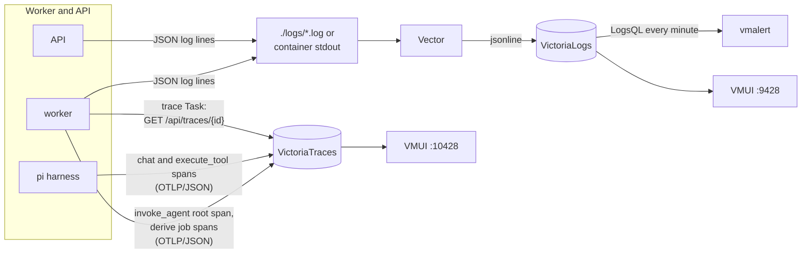

# Victoria in Memseek

Memseek uses two stores from VictoriaMetrics to collect what it does at run
time:

- **VictoriaTraces** holds spans: every step of a traced Agent run, and every
  derivation job.
- **VictoriaLogs** holds the worker's and API's JSON log lines, shipped by
  Vector.

Memseek stores neither spans nor logs itself. It writes them out through
standard protocols and reads traces back through one budgeted Task. This page
covers the whole integration: what runs, what each piece carries, how to look
at it, what we verified against the real stores, and what is left.

For step-by-step guides, see [Agent traces](agent-traces.md) and
[Following Memseek](observability.md).

## Why an external store, and why Victoria

The goal was to improve skills from real Agent runs, which needs full traces of
those runs. Storing spans is a solved problem, so Memseek does not do it.

- **Standards at the boundary.** Spans go out as OTLP/JSON over HTTP, and they
  come back through the Jaeger query API. Any store that accepts the one and
  serves the other works; Memseek's reader has no Victoria-specific code.
- **VictoriaTraces fits that boundary.** It is a single binary that ingests
  OTLP and serves the Jaeger API, with its own UI and query language.
- **One family for logs and traces.** VictoriaLogs uses the same query language
  (LogsQL) and the same UI (VMUI), so one skill covers both. vmalert runs
  alert rules written in that same language.

The decisions are recorded in [DECISIONS.md](https://github.com/memseekai/memseek/blob/main/DECISIONS.md)
under "Agent traces live in a trace store" and "Derivation jobs are traces
built from their run audit".

## The pieces

| Service | Image | Port (loopback) | Holds | Compose profiles |
|---|---|---|---|---|
| `victoriatraces` | `victoriametrics/victoria-traces:v0.13.0` | 10428 | Spans, 30 days | `traces`, `observability` |
| `victorialogs` | `victoriametrics/victoria-logs:v1.53.0` | 9428 | Log lines, 30 days | `logs`, `observability` |
| `vector` | `timberio/vector:0.59.0-alpine` | none | Nothing; ships logs | `logs`, `observability` |
| `vmalert` | `victoriametrics/vmalert:v1.156.0` | 8880 | Nothing; evaluates alert rules on the logs | `logs`, `observability` |

None of them has auth. They listen on loopback only, which suits local
development and nothing else; see [Production](#production).

## How data flows



| Path | Endpoint |
|---|---|
| Span ingest | `POST /insert/opentelemetry/v1/traces` on 10428 |
| Trace reads by the `trace` Task | `GET /select/jaeger/api/traces/{trace_id}` on 10428 |
| Log ingest by Vector | `POST /insert/jsonline?_msg_field=msg&_time_field=timestamp&_stream_fields=service,logger,level` on 9428 |
| Queries, both stores | `/select/logsql/query` |
| UIs | `/select/vmui/` on each port |

## Set it up

```sh
make observability          # starts all four; prints the UI links
```

Then give the worker these settings:

| Setting | Value locally | Who uses it |
|---|---|---|
| `TRACE_EXPORT_URL` | `http://127.0.0.1:10428/insert/opentelemetry/v1/traces` | The worker and each tracing harness, to send spans |
| `TRACE_EXPORT_TOKEN` | unset | Ingest-only bearer token, also handed to harnesses |
| `TRACE_STORE_URL` | `http://127.0.0.1:10428/select/jaeger` | The `trace` Task, to read traces |
| `TRACE_STORE_TOKEN` | unset | Query bearer token; never leaves the worker |
| `TRACE_STORE_TIMEOUT_S` | `10` | Per read |
| `TRACE_STORE_MAX_BYTES` | `8388608` | A larger trace is skipped as `too_large` |
| `TRACE_STORE_SETTLE_S` | `30` | How long a missing trace counts as still arriving |

Without `TRACE_EXPORT_URL` nothing is exported. Without `TRACE_STORE_URL` a
`trace` Task fails with `config`. URLs must be HTTPS except on loopback and
single-label hosts, such as a compose service name.

A worker or API run on the host, which the `local` Computer provider needs,
ships its logs by writing into `./logs`:

```sh
uv run memseek worker 2>&1 | tee -a logs/worker.log
```

## What gets traced

### Agent runs

Tracing is opt-in per Agent:

```yaml
agents:
  - name: worker
    harness: pi
    trace: {content: full}   # or metadata
```

For each run of a traced Agent:

- **The worker** mints the trace id and root span id, and exports the root
  span, `invoke_agent <agent>`, when the run ends. It exports it even when the
  run fails, times out or is cancelled, so the span always carries the outcome.
- **A harness that declares `trace: otlp`** gets `TRACEPARENT`,
  `OTEL_EXPORTER_OTLP_TRACES_ENDPOINT`, `OTEL_EXPORTER_OTLP_TRACES_HEADERS` and
  `MEMSEEK_TRACE_CONTENT` in its environment. The pi harness exports a
  `chat <model>` span per model call and an `execute_tool <name>` span per tool
  call, as children of the root. It strips those variables before starting pi,
  and skill packs never see them.
- **`content: full`** adds prompts, responses, tool arguments and results to
  the spans, using the OpenTelemetry GenAI attribute names. `metadata` keeps
  only names, timings, token counts and errors.
- **Memseek** writes one record per run to the built-in `agent_runs`
  collection, holding the trace id, status, error kind and metrics. That record
  is how derivations find the run's trace.

### Derivation jobs

With `TRACE_EXPORT_URL` set, every derivation job exports a trace, built from
its `_system` run audit after the audit is written:

- **The trace id is the run id** without dashes. The root span id is its second
  half.
- **`derive <derivation>`** is the root span. It carries status, error kind,
  trigger reasons, input and output counts, model calls and tokens.
- **`task <id>`** is one span per Task, placed at the offset the audit records
  for it, with its `use` and model-call count.

These spans carry identities and timings only. Prompts, records and error text
stay out of them.

### Links between traces

Traces join by links, not by nesting. Each link has a `memseek.link`
attribute; the Jaeger API shows links as `FOLLOWS_FROM` references.

| From | To | `memseek.link` |
|---|---|---|
| `derive <name>` | Each job that wrote a record this job read | `input` |
| `task <id>` of an `agent` Task | The Agent run it started | `agent_run` |
| `task <id>` of a `trace` Task | Each Agent run whose trace it read | `trace_read` |
| `invoke_agent <agent>` | The derivation job that started it | `derivation` |

Keeping each Agent run a whole trace of its own means the `trace` Task reads
exactly one run, within its byte budget.

## Reading traces back

The built-in `trace` Task fetches one Agent run's trace per run record it is
given, checks that the trace's root span belongs to that run, and renders it
as a numbered episode for a `judge` or `llm` Task. Its reads are capped by
`limits.max_trace_reads` and recorded as receipts in the run audit.

How the reader classifies the store's answers:

| The store answers | The Task does |
|---|---|
| A trace with this run's root span | Renders the episode |
| 404 with `{"data": [], "errors": [{"code": 404, "msg": "trace not found"}]}` | Retries with `transport` if the run is younger than `TRACE_STORE_SETTLE_S`, otherwise skips it as `not_found` |
| A trace without this run's root span | Same rule, with `no_root_span` |
| More than `TRACE_STORE_MAX_BYTES` | Skips it as `too_large` |
| A response that is not the Jaeger API, such as a 400 from a wrong base URL | Fails with `config`, so a bad URL cannot mark every trace missing |
| No answer, or a 5xx | Fails with `transport`, and the job retries |

## Logs

Vector's config is [observability/vector.yaml](https://github.com/memseekai/memseek/blob/main/observability/vector.yaml).
It reads the `api`, `worker`, `migrate` and `setup` containers through the
Docker socket, and every `*.log` file in `./logs`. Each JSON line keeps its own
fields. Vector adds `service`, which is the compose service or the log file's
name, and copies `event` to the message. Lines that are not JSON arrive with
`level` set to `raw`.

Every line written during a derivation job carries `trace_id` and `span_id`,
the same ids as the job's trace. That includes `run.completed`,
`derive.completed`, `job.retry_scheduled` and `job.dead_lettered`.

## Alerts

vmalert evaluates five rules on the log lines every minute: a derivation
failing repeatedly, a dead letter, a failed span export, an Agent run record
that could not be written, and a lagging projection. They show at
<http://127.0.0.1:8880/vmalert/alerts>; see [Following Memseek](observability.md#alerts)
for the table and for sending them to an Alertmanager.

## Looking at it

**Traces** at <http://127.0.0.1:10428/select/vmui/>:

- **One trace as a timeline.** Open `#/trace?trace_id=<id>`. Select a span to
  see its attributes, and use its **Links** tab to open linked traces.
- **Search.** The home page lists traces and has a view of errored spans.

**Logs** at <http://127.0.0.1:9428/select/vmui/>.

Queries that work against both stores today:

| Store | Query | Shows |
|---|---|---|
| Logs | `trace_id:=<id> \| sort by (_time)` | One job's lines |
| Logs | `level:error \| stats by (event) count()` | What is failing |
| Logs | `event:=job.dead_lettered \| stats by (workspace, kind, error_kind) count()` | Dead letters |
| Logs | `event:=derive.completed \| stats by (derivation) count(), sum(output_count)` | Throughput |
| Logs | `event:=projection.lag \| stats max(queue_lag_ms)` | Slowest projection |
| Logs | `event:=trace.export_failed` | Spans that could not be sent |
| Traces | `trace_id:<id> \| sort by (start_time_unix_nano)` | One trace's spans as rows |
| Traces | `name:invoke_agent*` | One row per Agent run |
| Traces | `name:"derive skill"` | Every run of one derivation |
| Traces | `"span_attr:error.type":*` | Every failed span |
| Traces | `"span_attr:memseek.origin.derivation":run_task` | Agent runs of one derivation |
| Traces | `"span_attr:memseek.derivation":run_task AND duration:>30s` | Slow jobs |

## What we verified against the real stores

Each of these was checked against VictoriaTraces v0.13.0 or VictoriaLogs
v1.53.0, and the code or docs follow it.

| Behavior | How Memseek handles it |
|---|---|
| A failed span is marked `error: "true"` with `otel.status_description`, and has no `otel.status_code` tag | The reader accepts both this and Jaeger's `otel.status_code: ERROR` |
| An unknown trace is a 404 with an empty `data` list | Read as not found |
| A wrong base URL answers 400 with a non-Jaeger body | Read as a configuration error |
| Parents arrive as `CHILD_OF` references, links as `FOLLOWS_FROM` | The reader uses `CHILD_OF` only |
| The Jaeger API returns a trace at once, while VMUI search can take up to a minute to show new spans | The `trace` Task reads through the Jaeger API; the docs warn about search |
| LogsQL field names containing `:` need quotes | The documented queries quote them |
| In vmalert, a `stats` without `by` returns a row even for a count of 0, so the rule fires constantly | Those rules end with `\| filter <count>:>0` |
| The VMUI trace view reads `/select/tempo/api/v2/traces/{id}` and takes `#/trace?trace_id=` | Test output and docs link to it |
| pi events that arrive together got equal millisecond timestamps, so the store ordered them arbitrarily | The pi harness's span clock now advances at least one microsecond per span |

## Tests

| Test | Covers |
|---|---|
| `tests/test_agent_traces.py` | Harness environment, root span export and failure paths, pi spans for both content settings |
| `tests/test_agent_traces.py::test_live_a_pi_run_can_be_read_back_from_victoriatraces` | A pi run sent to a real VictoriaTraces and read back; skipped unless `MEMSEEK_LIVE_TRACES` is set |
| `tests/test_trace_task.py` | The reader's classification, episode rendering, and the `trace` Task feeding a judge |
| `tests/test_agent_run_records.py` | Run records on every exit, and that a failed run does not re-trigger itself |
| `tests/test_derivation_traces.py` | Job spans, links across a chain, and log lines carrying the job's trace id |

`make traces-test` starts VictoriaTraces and runs the live test, printing the
episode and a VMUI link.

## What it found in practice

Real runs of the [agent trace learning example](https://github.com/memseekai/memseek/tree/main/examples/agent_trace_learning)
with `gpt-6-luna` and Jev turned up the following:

- **A rejected API key.** Every run failed with a `provider` error. The trace
  showed the cause, `401 invalid_api_key`, on the `chat` spans, with no log
  file opened.
- **A re-trigger loop.** A failed run's record re-armed its own derivation,
  first instantly and then through a sibling derivation's success, undoing
  retry backoff and reviving dead jobs. Both paths are fixed and recorded in
  DECISIONS.md.
- **Two bugs in the example.** Its `run_task` gave the harness no prompt, and
  its instructions named the wrong output shape.
- **A silent failure.** A run recorded as `ok` had failed its task: the file it
  needed did not exist, and its `find /` timed out after 20 of its 38 seconds.
  Jev scored it 0.09, and the `skill` derivation drafted a pitfall from the
  span that showed the timeout.
- **Stale workspaces.** The logs showed every older workspace in the local
  database failing to load its catalog on each cron pass. They use a retired
  catalog format or have none.
- **A judge that needs the task.** After a promoted skill made the agent fail
  fast and politely, Jev passed runs it had failed before. The episode's
  `Task:` line held the generic harness prompt, not the task, so a short "the
  file is missing" read as done. The example's `run_task` now puts the task's
  text in the prompt, and Jev judges both kinds of run as unaccomplished.
- **The loop pays off across two cycles.** With an empty skill, a missing-file
  task took 6 model calls, 10 tool calls and 47.9 s, ending in a search of the
  whole disk. After promoting the drafted skill, a new missing-file task took
  4 model calls, 7 tool calls and 12.6 s, searched only the agent's own
  folder, and gave the same answer. The trace showed both.
- **A sleeping laptop looks like a hung run.** One run took 853 s against a
  150 s limit. The Mac had gone into idle sleep a second after the run
  started, freezing every timer; `pmset -g log` shows it. Keep the machine
  awake, for example with `caffeinate -i`, for long local runs.

## Production

- **Put both stores behind auth**, for example vmauth, with separate ingest
  and query credentials. Set `TRACE_EXPORT_TOKEN` to the ingest one and
  `TRACE_STORE_TOKEN` to the query one. Harnesses receive only the ingest
  token.
- **Raw traces are outside Memseek's erasure.** Bound them with the store's
  retention, and use `content: metadata` where prompts must not leave.
- **The `local` Computer provider is unsandboxed.** A traced run on it can read
  the worker user's files; keep it to development.

## Not done yet

- **More job kinds.** Processor, projection and invocation jobs log but export
  no job trace.
- **`job.claimed`** is logged before the run id exists, so it has `job_id` but
  no `trace_id`.
- **Other harnesses.** Only pi exports spans from inside a run. Other Agents get
  the root span and a run record.
- **Lease loss.** A job cut off by a lost lease writes no run record and no
  trace.

## Where it lives

| Path | What |
|---|---|
| `src/memseek/tracing.py` | Trace ids, root and job spans, the OTLP/JSON exporter |
| `src/memseek/trace_store.py` | The Jaeger API reader and episode rendering |
| `src/memseek/agent_runs.py` | The run record and the built-in `agent_runs` collection |
| `src/memseek/logging.py` | JSON log lines and the trace context that stamps them |
| `harnesses/pi/otel.mjs` | The pi harness's span exporter |
| `observability/vector.yaml` | Log shipping |
| `observability/vmalert-rules.yaml` | Alert rules |
| `docker-compose.yml` | The three services and their profiles |
| `docs/agent-traces.md`, `docs/observability.md` | The user guides |
